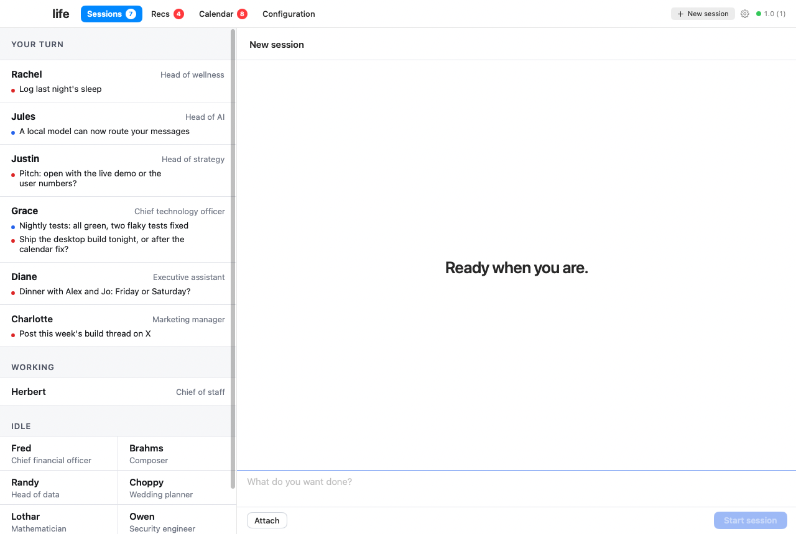
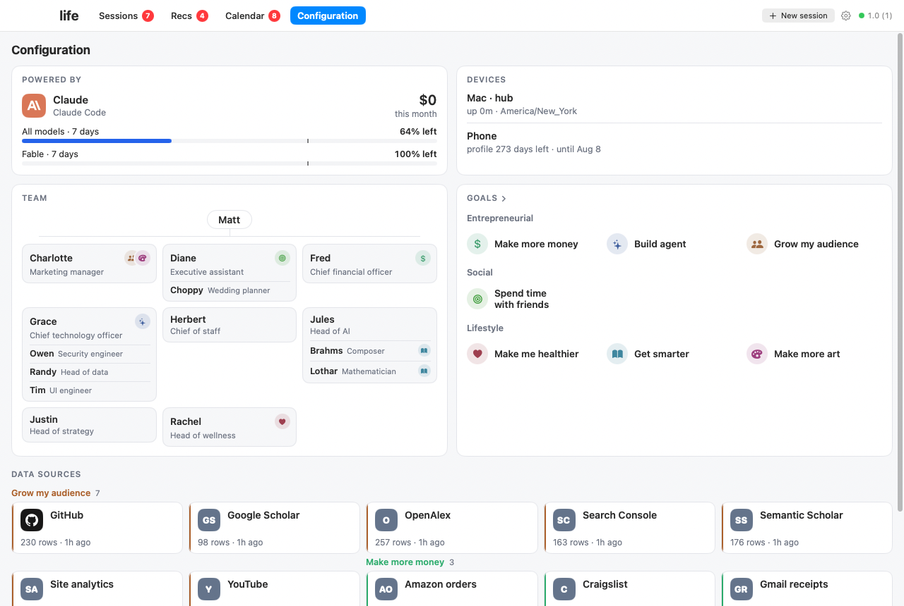
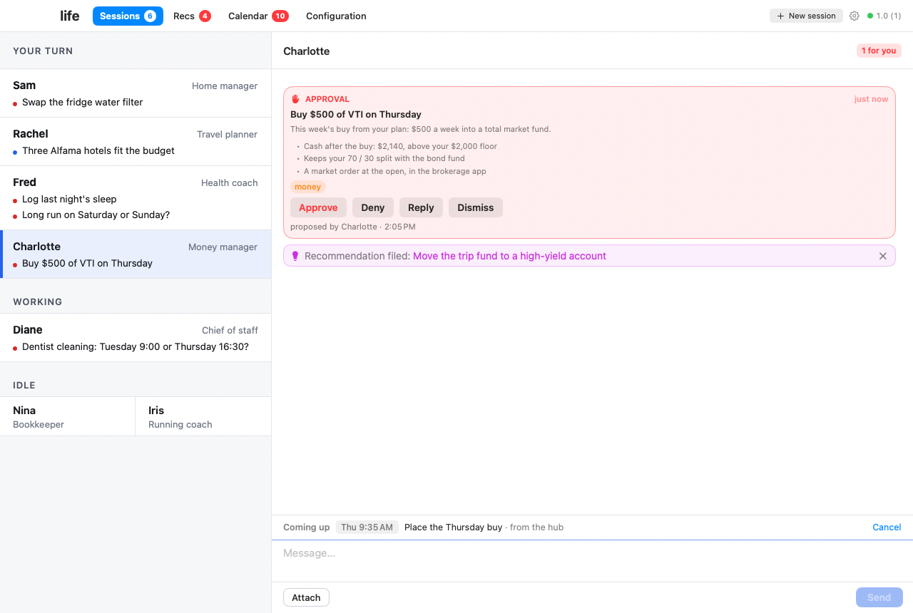
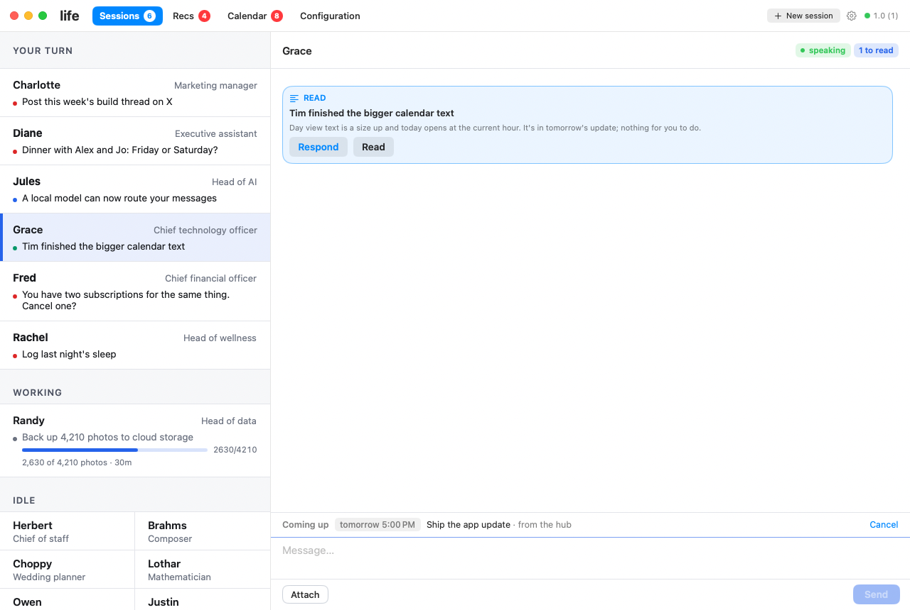
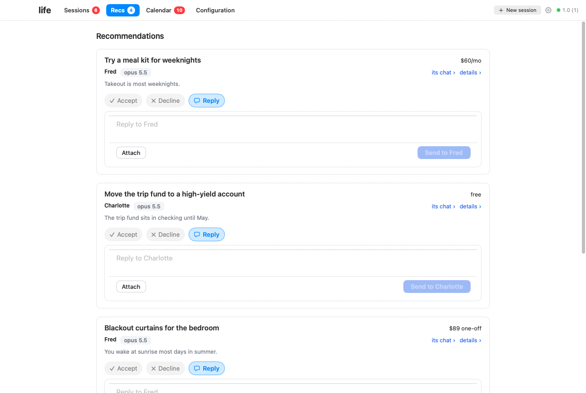
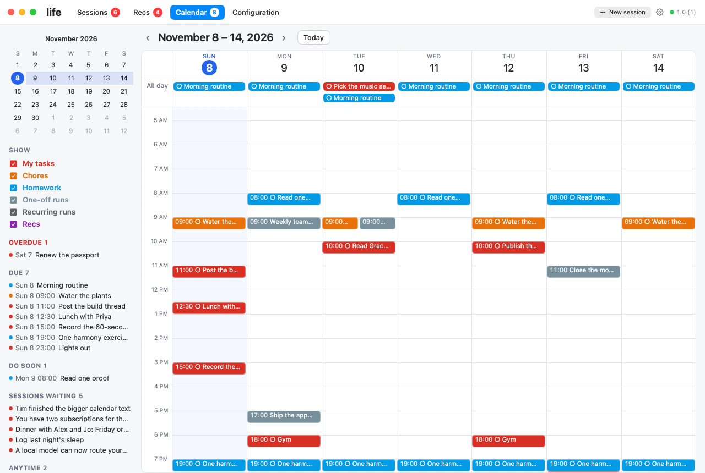
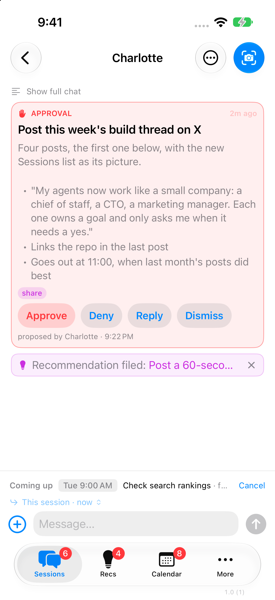
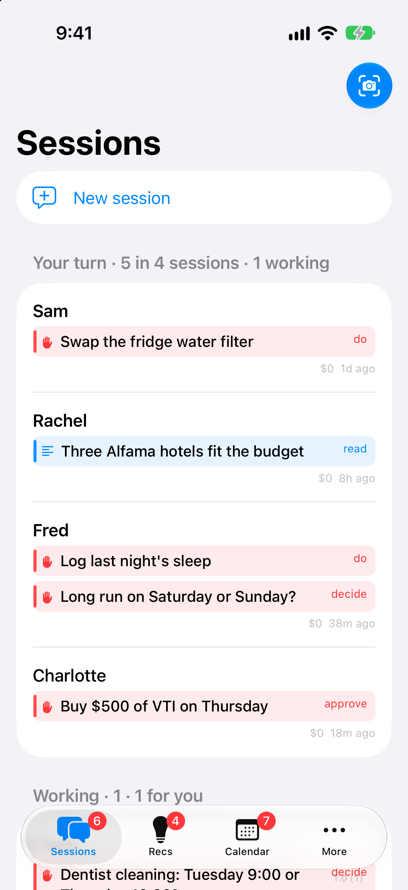
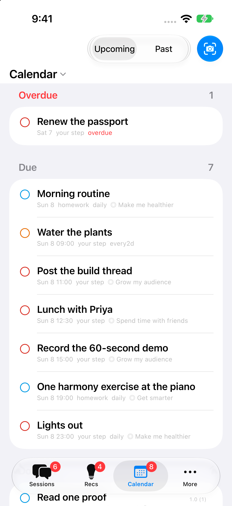
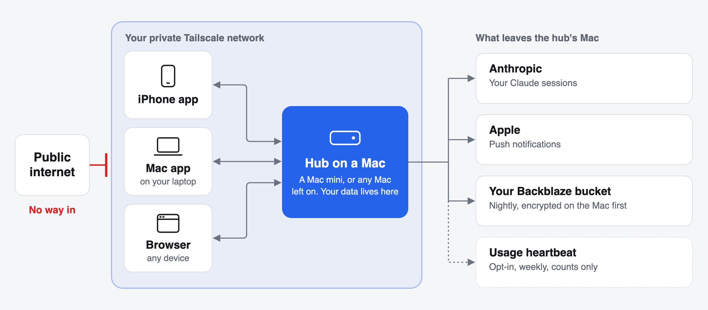

<p align="center"></p>

# life

**A self-hosted swarm of AI agents, with apps on iPhone, Mac and web.**

*life* is a self-hosted team of AI agents built on [Claude Code][claude-code].
It will help you meet your goals, whatever they are.

Your Mac runs the agents. It connects to your iPhone over a private
[Tailscale](https://tailscale.com) VPN, and you talk to the agents from an
iPhone app, a desktop app or a web app. Nothing is on the public internet.
Only your devices can reach it, and you can connect as many as you like: a
Mac mini, a laptop, a phone.

The agents can change their own apps. Ask for a new page, a new data source
or a new way of working, and they build it in your copy of the code.

As you work with them, they learn about you and your goals. They make
recommendations and take actions on your behalf, and anything that matters
waits for your yes. The data you share is saved on your Mac.

**Setup takes about 2 hours,** mostly waiting on Apple and the Xcode
download. **You need** a Mac that stays on, a
[Claude subscription][claude-pricing] (about $20 to $200 a month), and an
[Apple Developer membership][apple-dev] ($99 a year, only for the iPhone and
desktop apps).

## Install: paste one sentence

Open Claude Code on your Mac and give it this prompt.

```
Clone github.com/mattabate/life-distributable and set up my life agent. Follow its SETUP.md.
```

The agent runs the Terminal for you. Your part is clicking where it tells
you. You never type a command.

⭐ **[Star it][repo]** to get developer addenda: new features and fixes land
in [ADDENDA.md](ADDENDA.md) every week, and your agent brings each one to you.

<p align="center"></p>

**Configuration.** Your team, your goals, your devices, what the agents may
spend, and every data source under the goal it serves.

<p align="center"></p>

### Your first five minutes

You don't need to be technical.

1. Open **Terminal**: press **Cmd-Space**, type `Terminal`, press **Return**.
2. If you don't have Claude Code yet, install it with
   [Anthropic's guide][claude-code-setup].
3. In Terminal, type `claude` and press **Return**. Sign in with your
   Claude account if it asks.
4. Paste the sentence above and press **Return**.
5. From here, the agent leads. Do what it says, click where it points.

## What it does

- **A team, not a chat window.** Each agent is a long-running Claude Code
  session with a standing role. It keeps its memory and keeps working while
  you sleep. Say what you want and it goes to the agent whose job it is;
  anything nobody owns goes to the chief of staff, who adds new roles when
  you ask.
- **One screen for all of them.** Every agent has a cell showing what it is
  doing, what it is waiting on you for, and how far along its jobs are.
- **Talk to it.** Tap Option on the Mac, or the Mic button, and speak.
  Speech is turned into text on the Mac itself.
- **Puts a card on your phone when it needs you.** One clear thing to do,
  decide or read. Everything else it handles itself.
- **Asks before anything that matters.** Money, deleting, contacting
  people, sharing data and pushing code wait for your approval, with a code
  only you hold.
- **Tracks your goals.** Agents file what they learn under each goal, so
  every goal has a living "where this stands".
- **Recommends, with receipts.** Every suggestion goes in a ledger with its
  evidence and the price, so you can see later whether it worked.
- **Grows with you.** Sessions, Recs, Calendar and Configuration ship in
  the box. A page for anything else (money, a training log, a reading list)
  is something your agent builds when a goal needs one.

## Example app layout

### Desktop app

| **Approvals.** The agent proposes, you approve. | **Sessions.** It asks one clear question at a time. |
|---|---|
|  |  |

| **Recs.** Suggestions with evidence and a price. | **Calendar.** Your steps and the agent's runs. |
|---|---|
|  |  |

### iPhone app

<table>
<tr>
<th align="left"><strong>An approval.</strong> In your pocket.</th>
<th align="left"><strong>Sessions.</strong> Cards waiting on you.</th>
<th align="left"><strong>Calendar.</strong> Your day at a glance.</th>
</tr>
<tr>
<td valign="top"></td>
<td valign="top"></td>
<td valign="top"></td>
</tr>
</table>

The screenshots are the maker's own hub, with private details changed.

## What it costs

| What | Cost | Needed for |
|---|---|---|
| [Claude Pro or Max][claude-pricing] | $20, $100 or $200 a month | Everything. Max is better for an always-on agent |
| [Apple Developer Program][apple-dev] | $99 a year | Only the iPhone app and the desktop app. Web only? Skip it |
| [Tailscale](https://tailscale.com/pricing) | free | Reaching your hub privately from your phone and laptops |
| [Backblaze B2](https://www.backblaze.com/cloud-storage/pricing) | cents a month | Nightly encrypted backup |
| A Mac on macOS 15 or later | the one you own | The hub |

## Setup, in order

The agent follows [SETUP.md](SETUP.md). Here is the timeline.

1. **Pick your apps, see the costs** (2 min). iPhone, desktop, web, or all
   three. Later changes are built for the ones you picked.
2. **Start the slow things** (10 min, then waiting). Apple developer
   enrollment and the Xcode download start first. Apple usually answers
   within hours.
3. **Prepare the Mac** (10 min). Free tools, never sleep, disk encryption on.
4. **Your private copy on GitHub** (5 min). Your copy, your account, private.
5. **Tailscale** (10 min). A private network only your devices can join.
6. **The hub is up** (10 min). First milestone: the web console works.
7. **Backups** (15 min). Nightly, encrypted, to storage you own, tested
   with a real restore.
8. **Apple team and Xcode** (10 min). Once Apple says yes.
9. **The apps** (20 min). The desktop app opens, the iPhone app installs
   and buzzes.
10. **Your first goals** (15 min). The agent interviews you.
11. **Weekly updates and wrap-up** (5 min).

## How security works

Your data lives on your Mac. The hub listens only on your private
[Tailscale](https://tailscale.com) network, so nothing about it is public.

<p align="center"><picture><source media="(prefers-color-scheme: dark)" srcset="docs/img/security-dark.png"></picture></p>

- **Nothing public.** No open ports, no public URL. Your phone reaches the
  hub through Tailscale.
- **Outbound, only four places:** Anthropic (your Claude sessions), Apple
  (push notifications), your own backup bucket, and an optional weekly
  heartbeat to the project's [PostHog](https://posthog.com) analytics.
- **The heartbeat is off unless you say yes.** The agent asks once at
  setup, and the answer defaults to no. If you say yes, once a week it
  posts one event to `https://us.i.posthog.com/capture/` with a random
  install id and these fields only: `version`, `active_days`,
  `sessions_started`, `goals`, `pages` and `token_bucket` (a range such as
  "1-10M"), with GeoIP lookup disabled (`hub/internal/usage`). Never text,
  titles, names or amounts. Settings shows the payload and where it goes,
  and switches it off; `usage_host` in `ops/hub.json` sends it somewhere
  else.
- **Backups are yours.** Encrypted on your Mac before upload, so the
  storage only ever sees noise. The nightly key can't delete anything.
- **The gate.** Anything that spends money, deletes, contacts a person,
  shares data or pushes code needs your approval plus a decider code that
  only you hold. With sessions run as a separate user (SETUP.md, optional),
  no session can approve itself; without it a session runs as your account
  and could reach the code's hash, so the gate is a rule it follows, not a
  wall. A session can commit locally without asking; that commit stays on
  your Mac until a push is approved.

## Updates and addenda

- **The copy is yours.** Setup makes a private copy in your GitHub account.
  Change anything.
- **New every week.** The developer runs this same app daily, and each week
  its fixes and new pieces are ported here.
- **Your agent checks weekly.** It reads [ADDENDA.md](ADDENDA.md) every
  Monday and shows each new entry as a card on your phone.
- **Nothing lands without you.** Say yes and a new session applies that one
  update, fitted to your copy (which will have grown its own pages and look),
  tests it, and tells you what changed. Optional add-ons (like voice) arrive
  the same way, off until you opt in.

## FAQ

**Do I need to know how to code?**
No. The agent runs every command. You click, copy and paste where it tells you.

**Is my data sent anywhere?**
Your Claude sessions go to Anthropic, like any Claude Code session. Push
notifications go through Apple. Backups go to your own Backblaze bucket,
encrypted first. Nothing else, unless you opt in to the counts-only heartbeat
(to PostHog).

**Can I skip the iPhone app?**
Yes. Pick web only and skip the Apple Developer membership. The console
works in any browser on your Tailscale network, phone included.

**Does it run on Windows or Linux?**
The hub needs a Mac. Once it runs, the web console works from any device on
your Tailscale network.

**Can the agent spend my money or email people on its own?**
No. Those actions are gated. It proposes, you approve with your decider code.

**Is this an Anthropic product?**
No. It's an independent open source project built on Claude Code.

**What's in the folders?**
`hub/` is the server on your Mac and the web console it serves. `app/` is
the iPhone and desktop app. `shared/` is the contract between them, so the
two sides agree by test. `ops/` is the scripts that run one install: build
and start the hub, back it up nightly, install the apps, screenshot the
pages. Those scripts are the only commands a session may run, so that folder
is also the list of what the agent can do to your Mac.

## Who made this

[Matt Abate](https://mattabate.com), [@_laundry_matt_ on X](https://x.com/_laundry_matt_).
Questions and ideas: [open an issue][issues]. Want it set up for you or your
team? Get in touch through [mattabate.com](https://mattabate.com).

Found a security hole? [Report it privately](https://github.com/mattabate/life-distributable/security/advisories/new), not in an issue.

## License

MIT. See [LICENSE](LICENSE).

[repo]: https://github.com/mattabate/life-distributable
[issues]: https://github.com/mattabate/life-distributable/issues
[claude-code]: https://claude.com/claude-code
[claude-code-setup]: https://code.claude.com/docs/en/setup
[claude-pricing]: https://claude.com/pricing
[apple-dev]: https://developer.apple.com/programs/
